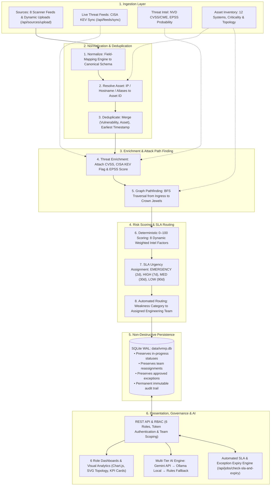

# System Guide: What Was Built, How It Works, and How Well

This explains the whole platform: what exists, what is connected to what, how a new CVE flows through, who sees what, and how efficient it is. For setup and the task list see `PROJECT_REPORT.md`.

## 1. What has been done so far
| Round | Delivered |
|---|---|
| 1 | Flask backend, 6 role dashboards, one HTML page per API, risk engine, dedup, attack path, tasks/SLA, exceptions, audit log, rule-based assistant |
| 2 | 8 finding sources, real CVEs with fake assets, team routing and urgency, reassign, team-filtered queues, Gemini AI layer with `.env.example` and safe fallback |
| 3 | Measured speed, simulated a new-CVE flow, this guide, future-work section |
| 4 | Cleaner dashboard UI: user menu, first-visit welcome guide, glossary, clickable risks that open an explanation panel, new `/api/findings/<id>/detail` endpoint |
| 5 | **SQLite persistence layer (`data/ivmrp.db`)**, non-destructive pipeline re-runs (preserving task progress, custom routing, and approved exceptions), dynamic scanner upload API & UI (`/api/sources/upload`), and 8 automated test suites (`tests/test_platform.py`) |
| 6 | **Tiered AI layer**: Google Gemini API → Ollama local models (e.g. `deepseek-coder:latest`) → deterministic rules fallback. Automatic local model detection and zero-dependency HTTP communication |
| 7 | **Docker containerization & shared persistence**: `Dockerfile`, `docker-compose.yml` with persistent volume mount (`./data`), enterprise authentication (salted password hashes, signed cryptographic tokens, `/api/me`, `/api/users`), server-side team scoping, and live CISA KEV threat feed sync (`/api/feeds/sync`) |
| 8 | **Visual Analytics, Topology Canvas & Governance Automation**: Interactive Chart.js charts (doughnut, BU bar, team workload), interactive SVG network attack path topology diagram (`/api/attack-paths/graph`), real-time search & multi-filter bar, automated exception expiry & SLA escalation engine (`POST /api/jobs/check-sla-and-expiry`), dynamic governance config API & UI (`PUT /api/config`), and 17 automated test suites |

## 2. What we use
| Piece | Technology | Why |
|---|---|---|
| Backend | Python 3 + Flask + Gunicorn WSGI | Lightweight, production-ready, API-first |
| Deployment | Docker + Docker Compose | One-command setup (`docker compose up -d`) across team members; host networking bridges to local Ollama; `./data` volume persists state |
| Data store | SQLite (`data/ivmrp.db`, standard library `sqlite3` in WAL mode) + in-memory cache | Zero external DB servers; persists tasks, exceptions, assets, users, and audit logs permanently across container restarts |
| Auth & Users | Salted password hashing (scrypt) + cryptographically signed tokens + `users` table | Real authentication with user management; automatically scopes task queues to a member's team (e.g. `backend-dev-team`) |
| Ingestion & Feeds | Field mapper + `/api/sources/upload` + Live CISA KEV sync (`/api/feeds/sync`) | Ingests scans from 8 built-in tools, user CSV/JSON uploads, and live external CISA threat feeds |
| Frontend | Plain HTML + one `app.js` + `style.css` + Chart.js CDN, generated by `gen_pages.py` | Zero build step; interactive Chart.js analytics, SVG attack path topology, and real-time client-side search |
| AI | Multi-tier: Google Gemini REST API → Ollama Local Models → Deterministic Rules (`urllib`, no SDK) | Cloud AI (Gemini) when key is configured, offline on-prem LLM (Ollama) when available, and automatic rules fallback |
| Config | `.env` + Dynamic Governance API (`PUT /api/config`) | Keeps secrets safe while enabling dynamic tuning of scoring weights and SLA turnaround days |
| Quality | Automated test suite (`tests/test_platform.py` via `unittest`, 17 test suites) | Verifies RBAC, password security, team scoping, persistence, feed sync, attack paths graph, dynamic config, automated expiry jobs, and AI backends |

## 2b. UI guide (how to use the screens)
- **Home & Auth Portal (`index.html`):** The secure authentication portal with tabbed Sign In and Account Creation forms, input validation, and a quick-fill demo profile drawer for rapid testing across all organizational roles.
- **Top bar:** shows the brand logo with vector shield icon, page title, current user role and team chip, and a single, unified hamburger menu button.
- **Unified Hamburger Menu:** replaces separate scattered buttons with a consolidated dropdown containing the user profile chip, 1-click Light/Dark theme toggle, role switcher, Guide & Glossary, API Catalog, and a single, direct Sign Out action. Dark/Light preference instantly adapts the UI and persists across sessions.
- **Welcome banner:** shown on your first visit to each dashboard with a one-line purpose and tips. Click "Got it" to hide it.
- **Cards:** every card has a title and a one-line explanation of what it shows. Charts and badges use colors: red = emergency, orange = high, yellow = medium, green = low or on track.
- **Click any risk row** (top risks, all findings, task queue, overdue list, exceptions) to open the side panel: *What is this risk?*, *Why is it in our system?* (sources, asset, business context, KEV/EPSS, attack paths), *Why this score and urgency* (factor bars), *Who fixes it and by when*, *How to fix it*, an AI explanation button, and a request-exception box for roles allowed to raise exceptions.
- **Plain-English text** in the panel comes from the platform's own data and category rules (`CAT` in `app.py`); Gemini is only used when you press the AI button.
- **Quick Scan Upload:** in Admin and Analyst dashboards under the "Import and scoring pipeline" card, submit scan records dynamically without editing raw JSON files.
- **Sync CISA KEV:** click "Sync CISA KEV" to fetch the live CISA threat catalog and escalate affected findings to emergency in real time.
- **Interactive Visual Analytics (Round 8):** Executive, Analyst, and Manager views feature interactive Chart.js doughnut and bar charts for urgency breakdowns, BU risk, and team workloads with automatic theme contrast adjustments.
- **Attack Path Topology Canvas (Round 8):** Visual SVG rendering of internet ingress perimeter nodes, intermediate application hops, and crown jewel targets with active attack traversal highlighting. Clicking any node inspects asset criticality, IP, and open vulnerabilities.
- **Real-Time Client-Side Search (Round 8):** Instantaneous search and multi-urgency filter bar above findings and task tables.
- **Alert Center & Automated Expiry Job (Round 8):** "Run SLA & Expiry Scan" button triggers `/api/jobs/check-sla-and-expiry` to automatically expire outdated exceptions and escalate overdue tasks.
- **Dynamic Governance Config (Round 8):** Admins can dynamically adjust intel scoring weights and SLA turnaround days directly in the UI via `PUT /api/config`.

## 3. File map
| Path | Role |
|---|---|
| `Dockerfile` | Multi-stage, non-root container image running Gunicorn production server |
| `docker-compose.yml` | Container orchestration with `./data` volume persistence and host networking |
| `README.md` | Standard GitHub project overview, quickstart, role logins, testing, and API guide |
| `app.py` | Everything on the server: pipeline, scoring, routing, auth, tasks, exceptions, AI, REST API |
| `db.py` | SQLite database schema, seeding, non-destructive upserts, user management, and persistent CRUD operations |
| `data/ivmrp.db` | Persistent SQLite database (WAL mode; git-ignored) storing findings, tasks, exceptions, users, and audit log |
| `data/assets.json` | 12 fake assets with business context (owner, criticality, internet exposure, crown jewel...) |
| `data/intel.json` | Vulnerability catalogue (13 real CVEs + 5 non-CVE findings), KEV flags, EPSS scores, asset links, score weights |
| `data/sources.json` | 8 sources, each with its own field-name mapping and records |
| `data/teams.json` | Category-to-team routing rules, team descriptions, urgency levels with SLA days |
| `static/` | Login & signup portal, 6 dashboards, 34 API pages (`static/api_*.html`, index: `api_index.html`), `app.js`, `style.css` |
| `tests/test_platform.py` | 17 automated test suites verifying auth, team scoping, pipeline, persistence, scoring, RBAC, feeds, topology graph, dynamic config, automated jobs, and AI |
| `.env.example` / `.env` | Environment configuration (Gemini keys, Ollama host, port, secrets) |

## 4. How everything is connected



```
 Sources (8 pre-configured JSON feeds + dynamic uploads via API/UI)   Intel: CVSS/CWE (NVD), KEV, EPSS     Assets + relationships
                            |                                                         |                                    |
                            v                                                         |                                    |
                 1 NORMALIZE (field-mapping config) -> common schema                  |                                    |
                            v                                                         |                                    |
                 2 RESOLVE ASSET (IP / hostname / alias -> asset_id) <---------------------------------------------+
                            v    (unmapped -> import-error list)
                 3 DEDUPLICATE on (vulnerability, asset): merge sources, keep earliest first_seen
                            v
                 4 ENRICH: CVSS/CWE/category from NVD data, KEV flag, EPSS            <-----+
                            v
                 5 ATTACK PATH: internet-exposed asset -> ... -> crown jewel (BFS)     <-----+ relationships
                            v
                 6 SCORE 0-100 (8 weighted factors, explainable)   -> risk level
                            v
                 7 URGENCY: EMERGENCY / HIGH / MEDIUM / LOW  (+ SLA days)
                            v
                 8 ROUTE to fixing team by vulnerability category (business owner kept separately)
                            v
                 9 PERSIST NON-DESTRUCTIVELY (SQLite: data/ivmrp.db)
                   * Inserts new findings & tasks
                   * PRESERVES user status (IN_PROGRESS/REMEDIATED/CLOSED)
                   * PRESERVES reassignments & approved exceptions
                   * Permanently records audit trail
                            v
 REST API (RBAC)  ->  Dashboards / API pages / AI assistant (Gemini explains, never decides)
```

## 5. A new CVE appears: the flow
I simulated this with a made-up `CVE-2026-9999` (CVSS 9.8) found by the Agent Scanner on `api-gateway`.
1. **Dynamic Ingestion:** Scanners submit findings via `POST /api/sources/upload` (JSON or CSV), or catalogue records are added to intel.
2. **Pipeline run** (`POST /api/pipeline/run` or upload trigger): the record is normalized, matched to `api-gateway`, deduplicated, and enriched.
3. **Result without KEV:** score **52, MEDIUM**, routed to **backend-dev-team** (category java-library), due in 30 days.
4. **When CISA adds it to KEV** (we add the KEV flag and rerun): score **72**, urgency **EMERGENCY** because it is now known-exploited and `api-gateway` is internet-facing, due in 2 days.
5. A task appears in the backend-dev-team queue and on the manager's overdue/workload views once late; every step is recorded in the permanent SQLite audit log.
6. **State Preservation (Round 5):** When developers update status (`IN_PROGRESS`), managers reassign teams, or exceptions are granted, subsequent pipeline runs or new scan uploads **never reset these changes**.

## 6. Who sees and can do what
| Role | Dashboard shows | Can change things? |
|---|---|---|
| Executive / CISO | KPIs, findings by urgency, risk trend & history, risk by business unit, top risks with CVE and fixing team, top risky assets, attack paths, expiring exceptions, AI summary | Read-only |
| Security Analyst | KPIs, urgency, risk trend, pipeline & CISA sync, all findings, top risky assets, sources, attack paths, expiring exceptions, AI assistant, exceptions | Run pipeline, sync feeds, upload scans, update/reassign tasks, request exceptions |
| Vulnerability / BU Manager | KPIs, team workload, overdue and escalated tasks, task queue, top risky assets, expiring exceptions, exceptions, tickets | Update/reassign tasks, approve/reject exceptions, run SLA scan |
| Fix team / Asset owner | Scoped team task queue (backend, frontend, infra, network, DBA, platform, cloud, IAM), exceptions, AI assistant | Update task status, request exceptions |
| Auditor | Expiring exceptions, exceptions, audit trail, routing rules, scoring config | Read-only |
| Platform Admin | KPIs, risk trend, AI status, pipeline & feeds, sources, routing, assets, top risky assets, expiring exceptions, dynamic config, audit, tickets | Everything, including adding assets, tuning weights/SLAs, and running pipeline |

**Access Control & Server-Side Team Scoping (Implemented in Round 7):**
- Authentication & permissions are strictly verified server-side on every API endpoint (HTTP 401 for missing/invalid bearer tokens, HTTP 403 for unauthorized roles).
- **Server-Side Team Scoping**: For users authenticated under the `owner` role, the server enforces team isolation directly at the database query level (`/api/tasks` automatically resolves the user's registered team, e.g. `backend-dev-team`, and returns only tasks belonging to their assigned team).
- **Cross-Team Governance Visibility**: Higher governance and triage roles (`admin`, `manager`, `analyst`, `executive`, and `auditor`) retain system-wide visibility across all teams by architectural design, enabling managerial workload balancing, cross-team escalations, and executive risk rollups. Non-owner roles can use the team selector as a triage filter.

## 7. How the score and urgency work
- **Score (0-100):** CVSS x30, known exploited 20, EPSS x15, internet exposure 10, asset criticality up to 10, sensitive data 5, regulatory 3, attack path 7. Every finding returns the per-factor breakdown (`/api/findings/<id>/risk`).
- **Urgency:** EMERGENCY (score >= 80, or known-exploited and internet-facing; 2 days), HIGH (>= 60; 7 days), MEDIUM (>= 40; 30 days), LOW (90 days).
- **Proof from the data:** the xz backdoor (CVSS 10.0) on a dev laptop scores 32 and can wait; Log4Shell on the payment API scores 100 and is an emergency.

## 8. How efficient is it? (measured)
Measured with Flask WSGI / Gunicorn and SQLite WAL mode on the demonstration environment:
| Benchmark / Metric | Verified Result | Notes |
|---|---|---|
| Ingestion & scoring pipeline (demo data: 24 raw records, 12 assets) | **6.3 ms** | Deduplicates, enriches KEV/EPSS, resolves assets, calculates attack paths, and upserts tasks non-destructively |
| Authenticated API latency (`/api/findings`, `/api/tasks`, `/api/analytics`) | **0.3 to 0.5 ms** | Sub-millisecond response time with server-side token validation |
| Automated integration test suite (`tests/test_platform.py`, 17 test suites) | **3.9 to 5.0 seconds** | 17 comprehensive unit/integration test suites executing end-to-end against live SQLite DB |
| Local AI inference latency (Ollama `deepseek-coder:latest`) | **~1.2 to 2.4 seconds** | Completely offline, on-premise local model inference via HTTP |
| CISA KEV live catalog sync (`POST /api/feeds/sync`) | **~1.8 seconds** | Streams and parses 1,770+ live CVEs from official CISA JSON feed and recalculates urgency |

Automation value on the demo data: 24 raw records from 8 tools became 18 findings (5 duplicates merged, 1 unmatched record logged), each already scored, prioritised, routed to a team and given a due date, which is the manual triage work the project aims to remove.

Resolved Inefficiencies:
- **Persistence Solved (Round 5):** Replaced volatile in-memory storage with SQLite (`data/ivmrp.db`). Pipeline re-runs and server restarts now preserve tasks, assignments, exceptions, and audit records permanently.
- **Dynamic Ingestion (Round 5):** Added `POST /api/sources/upload` and UI component for ingesting scans without manual configuration file edits.
- **Verification Solved (Round 5):** Added automated test suite covering RBAC, deduplication, scoring math, BFS attack paths, persistence, and AI fallback.

Resolved Inefficiencies & Security:
- **Enterprise Authentication (Round 7):** Replaced mock tokens with cryptographically signed tokens (`itsdangerous.URLSafeTimedSerializer`) and salted password hashes (`scrypt`/`pbkdf2`).
- **Server-Side Team Scoping (Round 7):** When a fix team member (`owner` role) accesses `/api/tasks`, their queue is automatically scoped to their assigned team (e.g. `backend-dev-team`).
- **Docker Portability (Round 7):** Containerized using multi-stage Docker and Gunicorn WSGI. Persistent `./data` volume guarantees shared state across team members.
- **Threat Intelligence Sync (Round 7):** Automated CISA KEV sync (`POST /api/feeds/sync`) pulls 1,700+ live CVEs and recalculates urgency in real time.
- **Visual Analytics & Topology (Round 8):** Replaced static tables and text bars with interactive Chart.js charts and an SVG network attack path topology diagram.
- **Automated Governance Housekeeping (Round 8):** Automated exception expiry and SLA escalation scan (`POST /api/jobs/check-sla-and-expiry`) eliminates risk rotting and manually tracking deadlines.
- **Dynamic Governance Tuning (Round 8):** Allowed administrators to tune scoring weights and SLA turnaround days via `PUT /api/config` and UI controls without editing database rows or code.

Remaining Inefficiencies and Risks:
- The attack-path search lists every path with no length limit; on a large, densely connected graph it could become slow.
- Production HTTPS/TLS termination should be handled via Nginx reverse proxy or cloud ingress.

## 9. Security notes
- API key stays server-side, is never returned by any endpoint, and `.env` is git-ignored.
- Passwords are securely hashed with salted cryptographic algorithms and verified via `check_password_hash`.
- Session tokens are cryptographically signed with server secrets and time-limited.
- The audit log is stored in the SQLite database permanently, surviving re-runs and restarts.

## 10. Delivery history
| Round | Focus | Deliverables |
|---|---|---|
| 1 | Prototype foundation | Flask backend, 6 role dashboards, 24 API pages, scoring engine, deduplication, BFS attack path, SLA tasks, exceptions, in-memory audit log, rules assistant |
| 2 | Threat intel & AI | 8 finding sources, real CVE catalog, team routing, urgency SLAs, reassignments, Gemini AI layer with rules fallback |
| 3 | Performance & flow | Benchmarking, new-CVE simulation walkthrough, initial system guide |
| 4 | UI Redesign | Navigation menu, welcome guide, glossary, clickable risk explanation side drawer, `/api/findings/<id>/detail` endpoint |
| 5 | Persistence & Robustness | SQLite database layer (`db.py`), non-destructive pipeline upserts, dynamic scan file upload (`/api/sources/upload`), automated test suite (`tests/test_platform.py`), updated system guide |
| 6 | Multi-Tier AI Engine | Tiered AI fallback: Google Gemini API → Ollama Local Models (`deepseek-coder:latest`) → deterministic rules. Automatic local model detection and UI backend indicator |
| 7 | Enterprise Portability & Auth | Docker containerization (`Dockerfile`, `docker-compose.yml`), persistent shared `./data` volume, salted password hashing, signed sessions, team scoping, user management (`/api/me`, `/api/users`), and live CISA KEV feed sync (`/api/feeds/sync`) |
| 8 | **Visual Analytics, Topology Canvas & Automation** | **Interactive Chart.js visualizations (urgency doughnut, BU bar, team workload), interactive SVG network topology diagram (`/api/attack-paths/graph`), real-time search & multi-filter bar, automated exception expiry & SLA escalation engine (`POST /api/jobs/check-sla-and-expiry`), dynamic governance config API (`PUT /api/config`), and 17 automated test suites** |

## 11. What is still pending
Live Gemini check with a real key; automated live NVD/EPSS scheduled cron feeds; graph database (Neo4j) for billion-edge traversal; notifications (Slack/email); CI/CD pipeline. The full table of what to add and which technology to use is in section 11 of `PROJECT_REPORT.md`.
